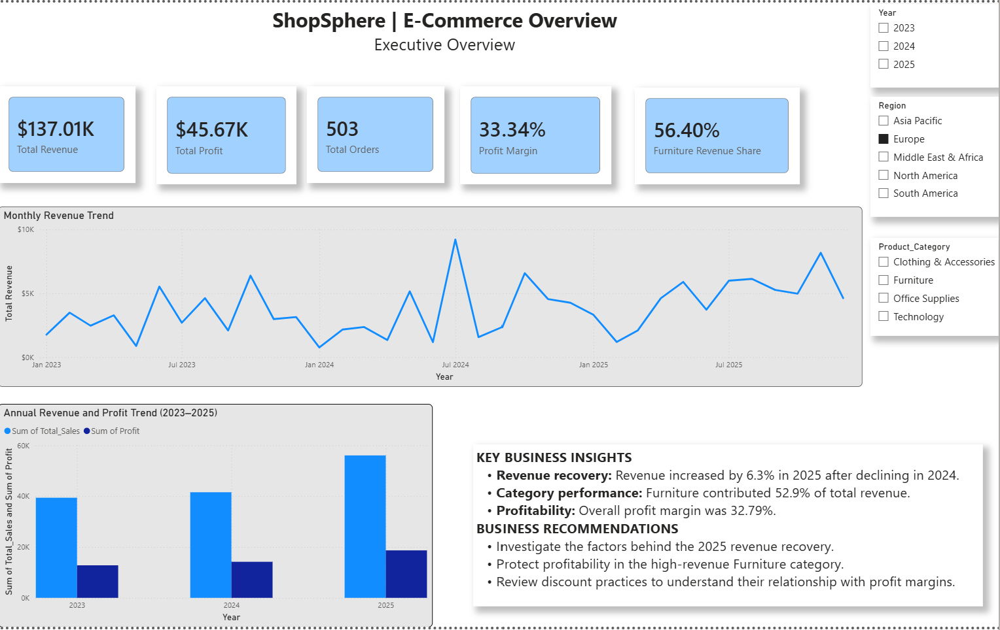
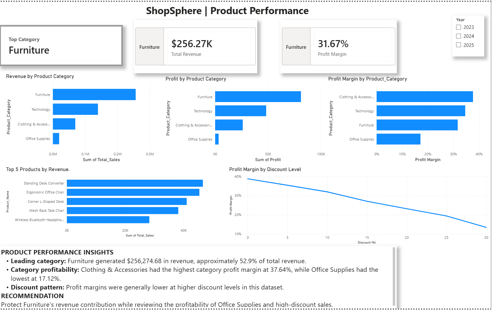
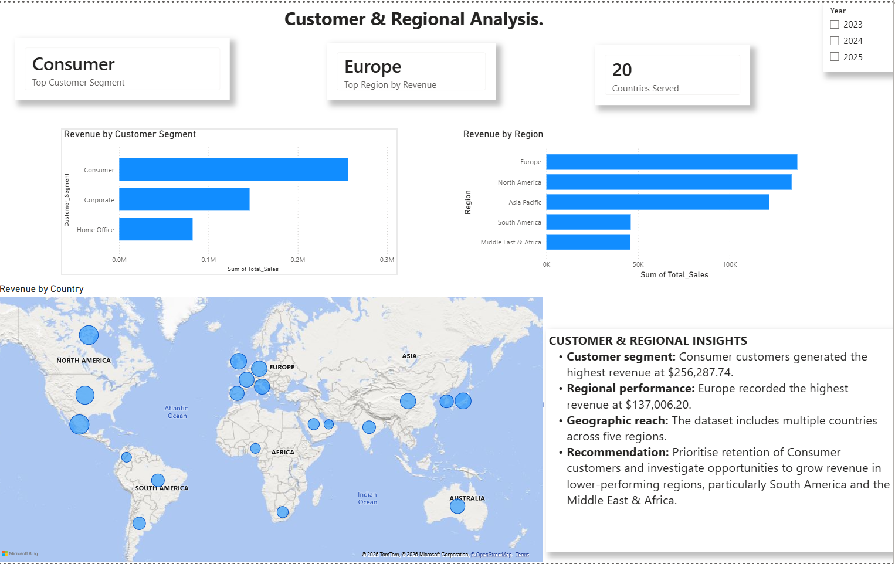

## ShopSphere E-Commerce Analytics Platform

## Project Overview

ShopSphere is an end-to-end e-commerce analytics project developed to explore sales performance, product profitability, customer segments, regional trends and discount patterns.

The project uses Python for exploratory data analysis and data quality checks, Google BigQuery for SQL-based analysis, and Power BI to build an interactive, three-page business intelligence dashboard.

## Dashboard Preview

### 1. Executive Overview



### 2. Product Performance



### 3. Customer and Regional Analysis



## Business Questions

This project investigates five key business questions:

1. How have revenue and profit changed over time?
2. Which product categories and individual products perform best?
3. How does purchasing behaviour differ across customer segments?
4. How do regions and countries perform?
5. How are discount levels associated with profitability?

## Tools and Technologies

- **Python:** Data inspection, exploratory analysis and data quality validation.
- **SQL:** Aggregations, business metrics, data validation and analytical queries.
- **Google BigQuery:** Cloud data storage and SQL analysis.
- **Power BI:** Interactive dashboard development, KPI cards, charts, slicers and geographic visualisation.
- **Git and GitHub:** Version control and project documentation.

## Data Quality

The dataset contains 2,000 e-commerce orders covering 2023–2025.

Validation checks confirmed:
- No missing values in the dataset.
- No duplicate order IDs.
- No invalid quantities or unit prices.
- No discount percentages outside the expected 0–30% range.
- No non-positive sales totals.
- No negative shipping costs.
- No discrepancies in the sales calculation beyond floating-point precision.

## Key Findings

### Revenue and Profit Trends

| Year | Revenue | Profit |
|---|---:|---:|
| 2023 | $164,443.45 | $53,153.74 |
| 2024 | $155,150.73 | $51,616.11 |
| 2025 | $164,965.16 | $54,102.47 |

Revenue and profit declined in 2024 before recovering in 2025. Revenue increased by approximately 6.32% year over year in 2025.

### Product Performance

- Furniture generated approximately 52.9% of total revenue.
- Clothing & Accessories recorded the highest category profit margin at approximately 37.64%.
- Office Supplies had the lowest category profit margin at approximately 17.12%.
- The Standing Desk Converter was the highest-revenue individual product in the analysis.

### Customer and Regional Performance

- Consumer customers generated the highest revenue among customer segments.
- Europe recorded the highest revenue among regions.
- Revenue was distributed across five geographic regions.

### Discount and Profitability

Profit margins generally declined as discount levels increased. This association suggests that discounting practices warrant further investigation, particularly where margins are already low. The analysis does not establish that discounts alone caused the lower margins.

## Power BI Dashboard

The dashboard contains three pages:

1. **Executive Overview** — headline KPIs and revenue trends.
2. **Product Performance** — category revenue, profit and margins; top products; and profitability by discount level.
3. **Customer & Regional Analysis** — customer segments, regional revenue and country-level geographic analysis.

## Project Structure
```text
ECommerce_Analytics_Platform-/
├── PowerBI/
│   └── ShopSphere_ECommerce_Analytics.pbix
├── docs/
│   └── business_analysis.md
├── python/
│   └── explore_data.py
├── screenshots/
│   ├── 01_executive_overview.png
│   ├── 02_product_performance.png
│   └── 03_customer_regional_analysis.png
├── sql/
│   ├── 01_data_quality_checks.sql
│   ├── 02_overall_kpis.sql
│   ├── 03_revenue_profit_trends.sql
│   ├── 04_product_category_analysis.sql
│   ├── 05_customer_segment_analysis.sql
│   ├── 06_regional_analysis.sql
│   └── 07_discount_analysis.sql
├── .gitignore
└── README.md
```
Note: The raw_data/ folder is excluded from the public repository through .gitignore.

## Business Recommendations

- Investigate the factors behind the 2024 decline and 2025 recovery.
- Protect the profitability of high-revenue product categories.
- Review pricing and discount strategies where margins are low.
- Explore opportunities to increase revenue in lower-performing regions.

## Project Purpose

This portfolio project demonstrates practical skills in data cleaning, exploratory data analysis, SQL, cloud analytics, business intelligence visualisation and translating analytical findings into business recommendations. GEN_AUS_PROJECT_REPO